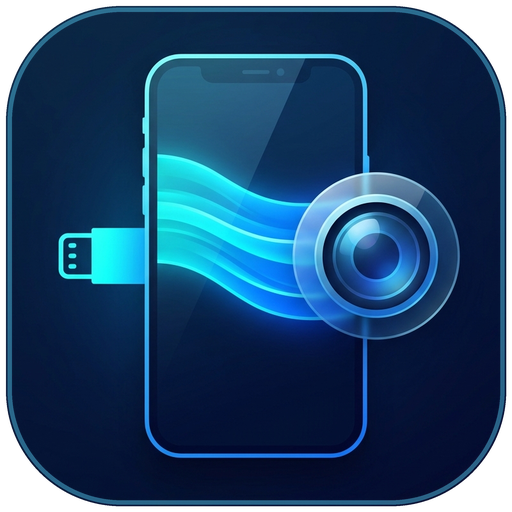

  

<h1 align="center">iOS USB 擷取卡 (iOS USB Capture Card) v1.3.0</h1>

  <b>Windows 10 / 11 專用 — iPhone / iPad 有線 USB 2K+ 原生自適應比例虛擬擷取卡 App（視訊 + 48kHz 無損音訊）</b> 
  免實體擷取卡 · 免越獄 · 免裝手機端 App · 免開測試模式 · 獨立桌面圖示一鍵啟動

---

## 一、下載與安裝（兩種方式任選，推薦直接下載 App 安裝包！）

請直接前往本專案右側的 **[Releases（發布頁面）](../../releases/latest)** 下載：

1. **📦 正式安裝版 App（最推薦）：`iOS-USB-Capture-Setup-v1.3.0.exe`**
   - 雙擊執行安裝精靈，會自動在**桌面**與**開始選單**建立帶有專屬圖示的 **「iOS USB 擷取卡」** App，並自動註冊 DirectShow 2K+ 虛擬擷取卡與微軟 WHQL 簽章驅動服務。
   - 日後若不使用，直接從 **Windows「設定 ➔ 應用程式 ➔ 已安裝的應用程式」** 點擊解除安裝即可自動清除乾淨。
2. **📁 免安裝綠色便攜版 App：`iOS-USB-Capture-Portable-v1.3.0.zip`**
   - 解壓縮後直接雙擊資料夾內帶專屬圖示的 **`iOS USB Capture.exe`**（或 `ios_vcam_gui.exe`）即可使用！

> **前置需求**：電腦需安裝微軟市集版 **Apple 裝置 (Apple Devices)** 或 **iTunes**（提供 Apple 原廠手機信任配對服務）。

---

## 二、30 秒快速開始教學

1. 開啟桌面上的 **「iOS USB 擷取卡」** App。
2. 用 USB 線連接 iPhone / iPad、轉好您要直播的橫向或直向畫面、解鎖手機並點擊 **「信任這部電腦」**。
3. 點擊 App 視窗中央的 **`🚀 智慧一鍵啟動`** 按鈕！
4. 開啟 **OBS Studio** ➔ 新增「視訊擷取裝置」➔ 選擇 **`iOS USB Capture Card (Video)`**（保持「裝置預設值」即可自動抓滿版 2K+ 原生比例、零黑邊！）；往下捲動勾選「使用自訂音訊裝置」➔ 選擇 **`iOS USB Capture Card (Audio)`**。

---

## 三、4 種畫質與比例模式（可於 App 內下拉切換）

| 模式名稱 | 行為說明 |
| :--- | :--- |
| **🌟 2K+ 原生自適應比例（預設）** | 自動依連接的 iPhone (`19.5:9` / `16:9`) 或 iPad (`4:3` / `1.44:1`) 吐出最高 **2.8K@60fps (`2868×1320` / `2752×2064`)** 原生點對點滿版畫面，零黑邊、畫質最銳利 |
| **✨ 1080p 自適應比例** | 維持機型真實長寬比（如 iPhone `1920×886`、iPad `1920×1440`）滿版零黑邊，同時降低舊電腦編碼負載 |
| **🖥 固定 2K 16:9 畫布** | 固定輸出 `2560×1440` 16:9 畫布，直播途中任意旋轉手機直橫屏會自動等比縮放補黑邊 |
| **🖥 固定 1080p 16:9 畫布** | 固定輸出 `1920×1080` 16:9 畫布，適合傳統視訊會議軟體 |

---

## 四、版本更新日誌 (Changelog)

完整歷史紀錄請參閱 **[CHANGELOG.md](CHANGELOG.md)**：

* **`v1.3.0` (2026-11-26)**：封裝為正式獨立 **Windows App**（內嵌專屬高解析度多尺寸 App 圖示與版本資訊，發布一鍵安裝檔 `Setup.exe` 與綠色便攜版 `Portable.zip`）。
* **`v1.2.0` (2026-11-26)**：新增 **2K+ 裝置原生解析度與真實比例自適應**（滿版無黑邊）、控制台 4 段畫質比例切換，以及即時 `Mbps` 碼率監控。
* **`v1.1.0` (2026-11-26)**：新增 **Windows 原生一鍵智慧圖形化控制台 (`ios_vcam_gui.exe`)**、電腦耳機零延遲音訊監聽選單，並改用微軟官方 Visual Studio (`MSVC`) 原生編譯消除防毒誤報。
* **`v1.0.0` (2026-11-26)**：初版發布，實作 Apple QuickTime / Valeria (`SubClass 0x2A`) 有線鏡像協定、免測試模式安全 `libusb0` UpperFilter 掛載器、`D3D11VA` 硬體解碼與雙路 DirectShow 視訊＋音訊虛擬擷取卡。
